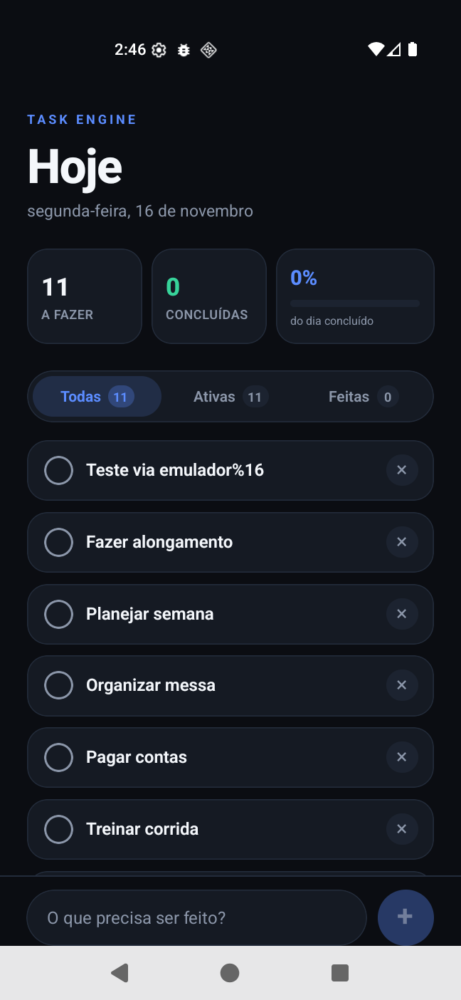
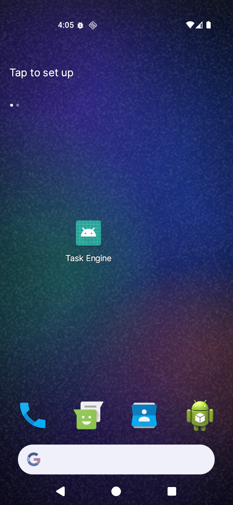

# Task Engine — Mobile

Aplicativo de lista de tarefas feito com **React Native puro** (sem Expo), **TypeScript** e
**AsyncStorage**. A interface é escura, com contadores do dia, barra de progresso e filtros por
status — tudo offline, com os dados salvos no próprio aparelho.

<p>
  
  
</p>
<br clear="left" />

[](https://github.com/BrendoLima/Task-Engine-Mobile/actions/workflows/ci.yml)


---

## Índice

- [Visão geral](#visão-geral)
- [Funcionalidades](#funcionalidades)
- [Stack](#stack)
- [Requisitos](#requisitos)
- [Instalação](#instalação)
- [Scripts](#scripts)
- [Arquitetura](#arquitetura)
- [Estrutura do projeto](#estrutura-do-projeto)
- [Emulador Android](#emulador-android)
- [Aparência estilo One UI](#aparência-estilo-one-ui)
- [Gerar APK para o celular](#gerar-apk-para-o-celular)
- [Qualidade e CI](#qualidade-e-ci)
- [Solução de problemas](#solução-de-problemas)
- [Limitações](#limitações)
- [Licença](#licença)

---

## Visão geral

O Task Engine é um app de tarefas de uma tela só: você adiciona tarefas no campo inferior, marca o
que já fez, filtra a lista e acompanha o progresso do dia. Não há login, backend nem sincronização —
as tarefas ficam no armazenamento local do aparelho (chave `@task-engine/tasks/v1`).

O projeto nasceu como um app React Native "bare" (`@react-native-community/cli`) e foi organizado
para rodar com um único comando no emulador Android e para gerar um APK `arm64-v8a` que instala
direto em um Galaxy A15 físico.

## Funcionalidades

- Adicionar tarefas pelo campo na parte inferior da tela (envia com o botão ou o teclado).
- Marcar e desmarcar tarefas como concluídas.
- Excluir tarefas individualmente.
- Filtrar por **Todas**, **Ativas** e **Feitas**, com contador em cada aba.
- Cartões de resumo: tarefas a fazer, concluídas e percentual do dia.
- Barra de progresso do dia.
- Limpar todas as tarefas concluídas de uma vez.
- Persistência local automática: ao fechar e abrir o app, tudo continua lá.
- Áreas seguras respeitadas (notch, barra de status e barra inferior) via
  `react-native-safe-area-context`.
- Lista virtualizada com `FlatList` (importante em telas pequenas e com muitas tarefas).

## Stack

| Camada | Tecnologia |
| --- | --- |
| UI | React Native 0.88.1 + React 19.3 |
| Linguagem | TypeScript 6.x |
| Estado | Hooks do React (`useState`, `useMemo`, `useCallback`) |
| Persistência | `@react-native-async-storage/async-storage` |
| Áreas seguras | `react-native-safe-area-context` |
| Testes | Jest + `react-test-renderer` |
| Lint / formatação | ESLint (config do React Native) + Prettier |
| Build Android | Gradle 9.4.1, AGP, NDK 27.1, minSdk 24, targetSdk 36, compileSdk 37 |

> Este projeto **não** usa Expo: não roda no Expo Go. É preciso compilar o app nativo.

## Requisitos

Para rodar no Android:

- **Node.js 22.11+** (o projeto foi validado no Node 24).
- **JDK 17**.
- **Android SDK** com `platform-tools`, `emulator`, `build-tools`, `platforms;android-36` e
  `ndk;27.1.12297006` (o Android Studio instala isso pelo SDK Manager).
- Variável `ANDROID_HOME` (ou `ANDROID_SDK_ROOT`) apontando para o SDK. Se nenhuma existir, os
  scripts procuram em `%LOCALAPPDATA%\Android\Sdk`.

Para rodar no iOS (apenas macOS): Xcode + CocoaPods (`bundle install && bundle exec pod install`).

> **Windows:** os scripts de automação (`npm run dev`, `npm run apk`, etc.) são PowerShell e foram
> escritos/validados no Windows. Em macOS/Linux use os comandos padrão (`npm start`,
> `npm run android`).

## Instalação

```bash
git clone https://github.com/BrendoLima/Task-Engine-Mobile.git
cd Task-Engine-Mobile
npm install
```

Se você usa PowerShell e o `npm` for bloqueado pela política de execução, prefira:

```powershell
cmd /c "npm install"
```

## Scripts

Todos os comandos abaixo rodam da raiz do projeto.

| Comando | O que faz |
| --- | --- |
| `npm run dev` | Fluxo completo no emulador `GalaxyA15`: sobe o AVD, Metro, build/install, aparência One UI e abre o app |
| `npm run dev:33` | O mesmo fluxo no AVD `TaskEngine33` (Android 13, mais fluido) |
| `npm run dev:fast` | Só emulador + Metro + abre o app já instalado (sem rebuild) |
| `npm run dev -- -Avd <nome>` | Escolhe outro AVD |
| `npm run dev -- -SkipBuild` | Igual ao `dev:fast` |
| `npm run dev -- -Restart` | Encerra e sobe o emulador do zero |
| `npm run dev -- -NoMetro` | Não sobe o Metro (útil se já houver um rodando) |
| `npm run dev -- -NoOneUI` | Não mexe em launcher/wallpaper (útil para testar o AOSP puro) |
| `npm run emu:stop` | Encerra o emulador |
| `npm run screen` | Mostra/troca resolução e densidade do emulador mantendo 411x891 dp |
| `npm run wallpaper` | Gera (se preciso) e aplica o wallpaper estilo One UI |
| `npm run oneui` | Reinstala/define o Lawnchair e aplica o wallpaper |
| `npm run apk` | Gera o APK release `arm64-v8a` em `dist\task-engine-arm64.apk` |
| `npm start` | Sobe apenas o Metro |
| `npm run android` | `react-native run-android` (build + install + Metro) |
| `npm run ios` | `react-native run-ios` (macOS) |
| `npm run typecheck` | `tsc --noEmit` |
| `npm run lint` | ESLint em todo o projeto |
| `npm test` | Jest |
| `npm run verify` | `typecheck` + `lint` + `test` (o mesmo que a CI roda) |

### O que `npm run dev` faz

O script `scripts/dev.ps1` executa, em ordem:

1. **Emulador** — reutiliza um dispositivo já conectado (`adb devices`); se não houver, sobe o AVD
   `GalaxyA15` com SwiftShader, sem snapshot, e espera `sys.boot_completed=1`.
2. **Ajustes** — restaura tamanho/densidade do AVD (`wm size/density reset`), desliga as animações
   do sistema e acorda a tela.
3. **Metro** — se a porta 8081 estiver livre, abre o bundler em uma janela separada com log em
   `dist\metro.log`; depois faz `adb reverse tcp:8081 tcp:8081`.
4. **Build/install** — roda `react-native run-android --active-arch-only --no-packager` e abre o app.
5. **Aparência One UI** — verifica se o home é o Lawnchair e se o wallpaper está aplicado; só
   reaplica o que estiver faltando. Se essa etapa falhar (por exemplo, aparelho sem root), o script
   avisa e continua.
6. **Confirmação** — espera o app aparecer em foco (`mCurrentFocus`) e imprime o resultado.

Detalhes de implementação relevantes:

- Os scripts chamam `node node_modules\react-native\cli.js` (e `node node_modules\eslint\...`) em vez
  de `npx react-native`/`eslint`. Neste Windows o `cmd` falha ao executar os shims sem extensão de
  `node_modules\.bin`. O mesmo ajuste existe em `android/settings.gradle` para o autolinking.
- O build C++ usa o `ninja` que vem com o CMake do SDK. A versão **1.10.2** falha neste projeto com
  `missing and no known rule to make it`; o `scripts\fix-ninja.ps1` troca por **1.13.1** (baixado uma
  vez para `dist\tools\ninja.exe`, guardando o original como `ninja.exe.bak`).
- O primeiro build demora alguns minutos; os seguintes reaproveitam o cache do Gradle/CMake.
- O emulador fica aberto ao final. `npm run emu:stop` encerra.

## Arquitetura

```
App.tsx
```

`App.tsx` é a única tela. Pontos principais:

- `SafeAreaProvider` + `SafeAreaView` cuidam de notch e barras; `KeyboardAvoidingView` evita que o
  teclado cubra o campo de nova tarefa.
- O estado vive em `TaskEngine`: lista de tarefas, filtro atual, rascunho do campo e um sinalizador
  `hydrated`.
- Na montagem, `loadTasks()` lê o AsyncStorage. Só depois de `hydrated = true` as alterações são
  salvas — isso evita sobrescrever os dados com a lista vazia inicial.
- Contadores e a lista visível são derivados com `useMemo`; as ações (`addTask`, `toggleTask`,
  `removeTask`, `clearCompleted`) usam `useCallback` e atualizações imutáveis.
- `FlatList` renderiza a lista (com `ListHeaderComponent` para o cabeçalho e `ListEmptyComponent`
  para o estado vazio/carregando).

```ts
// src/types.ts
export type Task = {
  id: string;
  title: string;
  done: boolean;
  createdAt: number;
};
```

Persistência (`src/storage.ts`):

- Chave: `@task-engine/tasks/v1`.
- `loadTasks()` faz parse defensivo: se o JSON for inválido ou algum item não tiver o formato de
  `Task`, o item é descartado em vez de derrubar o app.
- `saveTasks()` ignora falhas de escrita — sem persistência o app continua funcionando em memória.

Tema (`src/theme.ts`): cores, espaçamentos e raios centralizados. A paleta é escura
(`#0B0D12` de fundo), com azul (`#5B8CFF`) de destaque e verde (`#37D39A`) para progresso/concluído.

Componentes:

| Componente | Responsabilidade |
| --- | --- |
| `AddTaskBar` | Campo de texto + botão de adicionar; respeita o inset inferior |
| `FilterTabs` | Abas Todas/Ativas/Feitas com contadores |
| `TaskItem` | Checkbox, título riscado quando concluído e ação de excluir |
| `EmptyState` | Mensagem e ícone conforme o filtro atual |

## Estrutura do projeto

```text
Task-Engine-Mobile/
├── App.tsx                        # Tela principal e estado do app
├── index.js                       # Registro do componente raiz
├── src/
│   ├── components/
│   │   ├── AddTaskBar.tsx         # Campo de nova tarefa + botão
│   │   ├── EmptyState.tsx         # Estados vazios de cada filtro
│   │   ├── FilterTabs.tsx         # Filtros "Todas", "Ativas" e "Feitas"
│   │   └── TaskItem.tsx           # Item da lista (concluir/excluir)
│   ├── storage.ts                 # Persistência com AsyncStorage
│   ├── theme.ts                   # Cores, espaçamentos e raios
│   └── types.ts                   # Tipo Task
├── __tests__/
│   └── App.test.tsx               # Smoke test de renderização
├── android/                       # Projeto Android nativo (Gradle)
├── ios/                           # Projeto iOS nativo (CocoaPods)
├── scripts/
│   ├── dev.ps1                    # npm run dev: emulador + Metro + build/install + One UI
│   ├── metro.ps1                  # Metro em janela separada (log em dist\metro.log)
│   ├── start-emulator.ps1         # Sobe um AVD com as flags corretas
│   ├── configure-galaxy-a15-avd.ps1 # Ajusta tela/RAM do AVD GalaxyA15
│   ├── install-and-verify.ps1     # Instala o APK e valida a tela (screenshot + dump de UI)
│   ├── measure-performance.ps1    # Boot + carga de UI + estatísticas de frames
│   ├── screen.ps1                 # npm run screen: resolução/densidade (411x891 dp)
│   ├── set-wallpaper.ps1          # npm run wallpaper: aplica o wallpaper sem UI
│   ├── make-wallpaper.ps1         # Gera o PNG do wallpaper estilo One UI
│   ├── oneui.ps1                  # npm run oneui: launcher + wallpaper
│   ├── build-apk.ps1              # npm run apk: APK release arm64 para o celular
│   ├── fix-ninja.ps1              # Troca o ninja antigo do SDK (usado por dev e apk)
│   ├── wallpaper/
│   │   └── SetWallpaper.java      # Helper (app_process) que chama o WallpaperManager
│   └── diagnostics/
│       └── verify-studio-launch.ps1 # Diagnóstico de boot do emulador
├── docs/
│   └── images/                    # Screenshots usados neste README
├── .github/workflows/ci.yml       # Typecheck + lint + testes no GitHub Actions
├── .editorconfig                  # Convenções de indentação/linhas
└── dist/                          # Artefatos locais (APK, logs, screenshots) — ignorado pelo git
```

Arquivos gerados ficam em `dist/` e **não** são versionados: APK, `metro.log`, screenshots, dump de
UI e ferramentas baixadas (`lawnchair.apk`, `ninja.exe`, wallpaper).

## Emulador Android

### AVDs

| AVD | Android | Tela | Uso |
| --- | --- | --- | --- |
| `GalaxyA15` (padrão) | 16 / API 36 | 648x1404 @252 dpi (411x891 dp) | Fidelidade ao Galaxy A15 |
| `TaskEngine33` | 13 / API 33 | mesmo tamanho | Mais fluido (Android mais leve) |

Ambos usam imagem AOSP `default` (sem Play Services), GPU SwiftShader, 4 GB de RAM e 4 núcleos. O
AVD fica no SSD (`%USERPROFILE%\.android\avd`).

Criar o AVD do zero:

```powershell
avdmanager create avd -n GalaxyA15 -k "system-images;android-36;default;x86_64" -d pixel_5
powershell -NoProfile -ExecutionPolicy Bypass -File scripts\configure-galaxy-a15-avd.ps1
```

Configuração global do emulador: o arquivo `%USERPROFILE%\.android\advancedFeatures.ini` desliga
`WiFiPacketStream`, `NetsimWebUi` e `NetsimCliUi`. Sem isso o QEMU2 desta máquina trava na
inicialização e o emulador morre com `Exited with code 1`. O ajuste vale para terminal e para o
Android Studio.

### Por que SwiftShader

- A máquina de desenvolvimento tem uma Quadro 600 (Fermi), sem D3D12/ANGLE utilizável pelo emulador
  36.x. `-gpu host` falha com `MESA: error: D3D12CreateDevice failed`; `angle_indirect` foi removido.
- Todo o desenho é feito por software na CPU, então **resolução menor = fluidez maior**.
- Imagem AOSP sem Play Services deixa mais CPU/RAM para o app.
- AVD no SSD evita disputa de I/O com o HD.
- `-no-snapshot` evita retomar um estado inconsistente e um `ram.img` de 4 GB.

### Trocar resolução/densidade

A tela padrão entrega o mesmo espaço lógico do Galaxy A15 (411x891 dp, 19,5:9) com 648x1404 @252
dpi — 1,575 px por dp. É possível mudar sem editar o AVD:

```powershell
npm run screen                                    # mostra a atual e as opções medidas
npm run screen -- -Size 1080x2340 -Density 420    # resolução real do A15 (lento)
npm run screen -- -Reset                          # volta para 648x1404 @252
```

### Medições de fluidez

Feitas nesta máquina no `GalaxyA15` (Android 16), app release com ~12 tarefas, sempre na mesma
carga de UI (rolagens + troca de filtros). Todas as configurações mantêm 411x891 dp:

| Tela | Pixels | p50 | p90 | p95 | frames com jank |
| --- | --- | --- | --- | --- | --- |
| 432x936 @168 | 0,40 M | 16 ms | 24–25 ms | 26–28 ms | 3,8–16,9% |
| 576x1248 @240 | 0,72 M | 18 ms | 27–28 ms | 28–32 ms | 4,7–13,2% |
| **648x1404 @252 (padrão)** | **0,91 M** | **21–22 ms** | **29–31 ms** | **31–34 ms** | **6,2–23,9%** |
| 720x1560 @280 | 1,12 M | 24 ms | 32–34 ms | 34 ms | 8,4–29,1% |
| 864x1872 @336 | 1,62 M | 30 ms | 40 ms | 46–48 ms | 17,0–41,7% |
| 1080x2340 @420 | 2,53 M | 38–40 ms | 53 ms | 57 ms | 37,9–54,0% |

Leitura rápida: até ~1 MP o app fica próximo dos 60 fps; acima disso o SwiftShader vira o gargalo
(~40 fps em 1,62 MP, ~26 fps em 1080x2340). O `TaskEngine33` (Android 13) rende ~15% melhor para a
mesma tela.

Para medir por conta própria:

```powershell
adb shell dumpsys gfxinfo com.taskengine.mobile reset
# use o app por alguns segundos
adb shell dumpsys gfxinfo com.taskengine.mobile
```

Ou use `scripts\measure-performance.ps1`, que faz boot + install + launch + carga de UI e imprime
`Janky frames` e os percentis 50/90/95/99.

### Pelo Android Studio

1. Abra o Android Studio e o projeto `Task-Engine-Mobile`.
2. Abra **Tools > Device Manager**.
3. Selecione o AVD **GalaxyA15** e clique em **Run** (▶).
4. Se o AVD não aparecer, confira o caminho do SDK em **Device Manager > ⋮ > Virtual Device
   Manager**.

O boot demora alguns minutos na primeira vez por causa do SwiftShader.

## Aparência estilo One UI

O firmware Samsung não roda no emulador (One UI é framework + SystemUI + apps da Samsung; não há
ROM/GSI dela para emulador). O que dá para fazer é deixar a **home** próxima do One UI com dois
ajustes reversíveis:

1. **Launcher** — [Lawnchair 15.0.0-beta3](https://github.com/LawnchairLauncher/lawnchair/releases)
   (open-source, APK oficial do GitHub) definido como home, com grid **4x6** (padrão do A15).
2. **Wallpaper** — gradiente azul-noite/roxo/teal com blobs e grão, gerado por
   `scripts\make-wallpaper.ps1` em `dist\tools\wallpaper-oneui.png` (prévia em
   `docs/images/wallpaper.png`).

Recriar a aparência:

```powershell
npm run oneui                # instala o Lawnchair (se preciso), define como home e aplica o wallpaper
```

O próprio `npm run dev` já reaplica o que estiver faltando — esse comando existe para quando você
quer só a aparência, sem build.

Passo a passo manual:

```powershell
npm run wallpaper            # gera o PNG se preciso e aplica via WallpaperManager
adb install -r dist\tools\lawnchair.apk
adb shell cmd package set-home-activity app.lawnchair/app.lawnchair.LawnchairLauncher
```

O wallpaper **não** usa a galeria: o picker/cropper do AOSP desenha em `SurfaceView` com GL e
derrubou o emulador (SwiftShader) duas vezes. O script roda um `app_process` como uid 1000
(`su 1000,1000`) e chama `WallpaperManager.setStream` direto — por isso precisa de `adb root`, que
só existe em imagem AOSP userdebug/emulador. O código está em
`scripts\wallpaper\SetWallpaper.java`.

Reverter para o AOSP:

```powershell
adb shell cmd package set-home-activity com.android.launcher3/com.android.launcher3.uioverrides.QuickstepLauncher
adb uninstall app.lawnchair
```

Limites honestos:

- Barra de status, quick settings e notificações continuam AOSP.
- O Lawnchair pode dar **ANR** sob carga (SwiftShader + 4 vCPUs, principalmente durante um build).
  Com o sistema ocioso, ciclos home/app passaram sem ANR. Depois de um ANR, toque em **Wait**.
- Medições com Lawnchair residente e com launcher AOSP na mesma sessão deram o mesmo resultado
  (p50 ~22 ms): a diferença entre sessões é maior que o custo do launcher.

## Gerar APK para o celular

O APK do emulador é `x86_64`. Para o aparelho físico (Galaxy A15) é preciso um APK **arm64-v8a**:

```powershell
npm run apk
```

O `scripts/build-apk.ps1` roda `assembleRelease` com `-PreactNativeArchitectures=arm64-v8a`, embute o
bundle JavaScript (não precisa de Metro) e copia o resultado para `dist\task-engine-arm64.apk`
(≈19,4 MB; ~2,5 min no primeiro build). A assinatura usa `android\app\debug.keystore` — a mesma do
template do React Native: serve para testar no aparelho, **não** para publicar na Play Store (para
isso é preciso um keystore próprio e `signingConfigs.release`).

Com o celular conectado por USB e a depuração USB ativada:

```powershell
adb install -r dist\task-engine-arm64.apk
adb shell am start -n com.taskengine.mobile/.MainActivity
```

Sem cabo: copie o APK para o celular (Drive, cabo em MTP, etc.), abra pelo gerenciador de arquivos e
permita "instalar apps desconhecidos" para o app usado. Se a assinatura mudar, desinstale a versão
anterior antes (`adb uninstall com.taskengine.mobile`).

Outras arquiteturas:

```powershell
npm run apk -- -Arch armeabi-v7a                    # aparelhos 32 bits antigos
npm run apk -- -Arch arm64-v8a,armeabi-v7a,x86_64   # APK universal (maior, serve em tudo)
```

Conferir o que saiu no APK:

```powershell
& "$env:LOCALAPPDATA\Android\Sdk\build-tools\37.0.0\aapt2.exe" dump badging dist\task-engine-arm64.apk |
  Select-String "package:|SdkVersion|native-code"
```

> O `dist\` é ignorado pelo git. O APK é um artefato local, não faz parte do repositório.

## Qualidade e CI

```bash
npm run typecheck   # tsc --noEmit
npm run lint        # ESLint
npm test            # Jest
npm run verify      # os três em sequência
```

O workflow `.github/workflows/ci.yml` roda `npm ci`, `typecheck`, `lint` e `test` no GitHub Actions a
cada push na `main` e em pull requests.

O teste atual (`__tests__/App.test.tsx`) é um smoke test: renderiza o app e garante que nada quebra
na inicialização. A persistência é testada indiretamente pelo parse defensivo de `storage.ts`.

## Solução de problemas

| Sintoma | Causa / solução |
| --- | --- |
| `npm.ps1 não pode ser carregado porque a execução de scripts foi desabilitada` | Política de execução do PowerShell. Use `cmd /c "npm ..."` ou `Set-ExecutionPolicy -Scope Process Bypass` |
| `'eslint' não é reconhecido` / `'react-native' não é reconhecido` | Shim de `node_modules\.bin` falhando no `cmd`. Os scripts já chamam `node node_modules\...` diretamente |
| `ninja: error: '...node_modules/...', missing and no known rule to make it` | Ninja 1.10.2 do CMake do SDK. Rode `npm run dev` uma vez (o `fix-ninja.ps1` troca para 1.13.1) |
| Tela vermelha "Unable to load script" | Metro não está rodando ou `adb reverse` caiu. Rode `npm start` e `adb reverse tcp:8081 tcp:8081` |
| Emulador fecha com `Exited with code 1` | Ajuste o `advancedFeatures.ini` (ver [Emulador Android](#emulador-android)) |
| `adb devices` mostra `unauthorized` | Aceite "Permitir depuração USB?" na tela do celular |
| `INSTALL_FAILED_UPDATE_INCOMPATIBLE` | Assinatura diferente da versão instalada: `adb uninstall com.taskengine.mobile` |
| ANR no launcher | Emulador sob carga. Toque em **Wait** ou reverta para o launcher AOSP |
| `WallpaperManager` falha / `adbd cannot run as root` | O wallpaper precisa de imagem AOSP userdebug + `adb root`. Em aparelho físico comum, pule a etapa (`-NoOneUI`) |
| App abre, mas o build demorou e a janela do Metro sumiu | Feche e rode `npm run dev:fast`; o log fica em `dist\metro.log` |

## Limitações

- **One UI real** não é reproduzível no emulador: apenas launcher + wallpaper. `Build.MODEL`
  continua genérico.
- **1080x2340 @420** (resolução real do A15) não roda a 60 fps com SwiftShader (~26 fps).
- **90 Hz** não existe no emulador (60 Hz).
- Sem backend, sem conta, sem sincronização entre aparelhos.
- APK assinado com keystore de debug — não publicável na Play Store como está.
- A automação de emulador/One UI é específica de Windows (PowerShell + `adb`).

## Licença

MIT. Veja o campo `license` em `package.json`.
